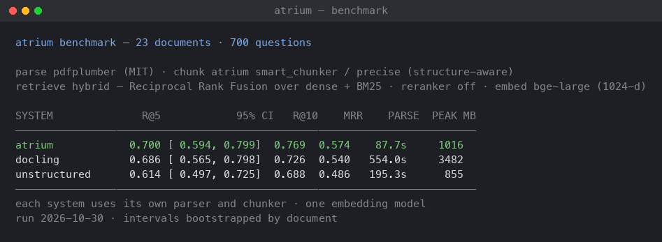

# Atrium

**Put a folder of PDFs, Word documents and spreadsheets somewhere, and ask it questions in plain language.**

Atrium reads a document into its structure, cuts it into chunks that keep
that structure attached, embeds those chunks, and stores them in a vector
database. A later question finds the paragraph that answers it — and the
page it came from.

```bash
pip install atrium-rag
```



- **Python:** 3.10+
- **Vector DB:** SQLite (default), Qdrant or pgvector
- **Embeddings:** any OpenAI-compatible `/v1/embeddings` endpoint (Ollama, OpenAI, vLLM, LM Studio, TEI) — or none, with the in-process embedder
- **License:** MIT

---

## Install

```bash
pip install atrium-rag
atrium init
```

`atrium init` looks at what is installed, asks which vector store and
which embedding provider you want, offers to pull a model or start a
container, shows you the configuration before it is written, and then
checks it by making a real embedding call. Everything it offers to do, it
asks first.

With no server running, choose **in-process** when it asks and it offers
to install the extra itself — a small model on your machine, no key, no
GPU. The default vector store is a SQLite file next to your project.

---

## Use it

### Over HTTP

```bash
atrium serve            # http://localhost:8000, docs at /docs
```

```bash
curl -X POST http://localhost:8000/ingest \
    -F "files=@./report.pdf"

curl -X POST http://localhost:8000/search \
    -H 'Content-Type: application/json' \
    -d '{"query": "What is the retention policy?", "top_k": 8}'
```

One file is one entry in `files`; several files in one request are
ingested at the same time and each gets its own record back.

### From the shell

```bash
atrium ingest ./docs/
atrium search "What is the retention policy?"
atrium reingest ./docs/policy.md --doc-id policy --chunking-mode context_rich
```

### From Python

```python
from atrium.pipeline import ingest_document
from atrium.adapters import QdrantAdapter
from atrium.embedder_config import build_embedder
from atrium.universal_parser import UniversalParser
from atrium.retrieval import retrieve_and_rerank

db = QdrantAdapter(host="localhost", port=6333)
embedder = build_embedder()
db.ensure_collection("documents", embedder.dimension)

ingest_document(
    doc_id="report",
    file_bytes=open("report.pdf", "rb").read(),
    filename="report.pdf",
    mime_type="application/pdf",
    parser=UniversalParser(),
    embedder=embedder,
    db=db,
)

hits = retrieve_and_rerank(db, embedder.embed(["retention policy"])[0],
                            "retention policy", top_k=8)
for hit in hits:
    print(hit["score"], hit["page_number"], hit["text"][:80])
```

---

## The API

| Endpoint | What it does |
|---|---|
| `POST /ingest` | Ingest files inline — parsed, embedded and stored before the response |
| `POST /jobs` | Queue a file for the worker; returns `202` + `job_id` |
| `GET /jobs/{job_id}` | Job status: `pending`, `running`, `complete`, `failed` |
| `POST /search` | Search the corpus |
| `GET /health` | Liveness + dependency probe |
| `POST /preview` | Parse + chunk a document without embedding or storing it |

`POST /preview` is how you check what the parser made of a document
before you commit it to the corpus.

### `POST /search`

```bash
curl -X POST http://localhost:8000/search \
    -H 'Content-Type: application/json' \
    -d '{"query": "retention policy", "top_k": 8, "rerank": false}'
```

Only `query` is required. `top_k` falls back to `DEFAULT_TOP_K`;
`rerank` is a tri-state — `true` forces it on, `false` forces it off,
omitted follows `RERANK_ENABLED`.

```json
{
  "query": "retention policy",
  "top_k": 8,
  "rerank": false,
  "count": 8,
  "corpus_chunks": 1451,
  "took_ms": 41,
  "results": [
    {
      "rank": 1, "score": 0.78, "chunk_id": "…", "doc_id": "policy",
      "text": "…", "page_number": 3, "section_path": ["Retention"],
      "element_type": "paragraph", "chunking_strategy": "structure_aware",
      "is_parent": false, "parent_id": null
    }
  ]
}
```

Every result carries where it came from: the page, the heading path, the
element type and the chunking strategy that produced it.

### `POST /jobs`

Queue a document for asynchronous ingestion. The response is immediate; a
worker does the work.

```bash
curl -X POST http://localhost:8000/jobs -F "file=@./big-report.pdf"
```

Bodies over 50 MB get `413`; a file whose declared content type
contradicts its bytes gets `415`. A worker drains the queue:

```bash
python -m atrium.worker
```

Workers claim jobs atomically, so several can share one queue file
without processing a document twice.

### Chunking

A chunk is a slice of a document, and the slice decides how well the
document can be searched later. Atrium ships five ways to cut one:

| Strategy | What it does |
|---|---|
| `baseline` | A sliding window over characters. Fastest. |
| `sentence_bounded` | Splits on sentence boundaries, then packs the sentences up. |
| `recursive_token` | Splits small, then merges upward. |
| `structure_aware` | Respects the element types: tables stay whole, code stays whole, headings ride on top as a breadcrumb. |
| `parent_child` | Wide parents for context, small children for retrieval. |

You pick one with `chunking_mode`:

| Mode | Strategy | Sizes |
|---|---|---|
| `auto` (default) | `structure_aware` | 700 chars, 100 overlap |
| `balanced` | `baseline` | 1000 chars, 150 overlap |
| `precise` | `structure_aware` | 700 chars, 100 overlap |
| `context_rich` | `parent_child` | 1000-char children under 3000-char parents |
| `custom` | any of the five | yours |

```bash
curl -X POST http://localhost:8000/ingest \
    -F "files=@./doc.pdf" \
    -F "chunking_mode=custom" \
    -F 'chunking_config={"strategy": "sentence_bounded", "target_chars": 900}'
```

`auto` is `precise` today — the same structure-aware cut for every
document. The strategy that actually ran is stamped on every chunk, so a
corpus built with mixed strategies stays auditable.

---

## Configuration

Every setting is an environment variable. Put them in `.env` (run
`atrium init` to generate one) or export them. A real environment
variable beats `.env`, and `.env` beats the built-in default. The full
list, with comments, is in `.env.example`.

| Variable | Default | What it does |
|---|---|---|
| `VECTOR_DB` | `sqlite` | `sqlite`, `qdrant` or `pgvector` |
| `ATRIUM_BIND` | `127.0.0.1` | The address `atrium serve` binds |
| `LOCAL_DB_PATH` | `atrium_local.db` | Where the local store keeps its file |
| `QDRANT_HOST` / `QDRANT_PORT` | `localhost` / `6333` | Qdrant address |
| `PG_CONN` | — | Postgres DSN, when `VECTOR_DB=pgvector` |
| `EMBED_BASE_URL` | `http://localhost:11434/v1` | Any OpenAI-compatible `/v1` endpoint |
| `EMBED_API_KEY` | — | Key for that endpoint; blank for local servers |
| `EMBED_PROVIDER` | `http` | `http`, or `fastembed` for the in-process embedder |
| `EMBED_MODEL` | `bge-large` | Model name, as that endpoint knows it |
| `EMBED_DIM` | `1024` | Must match the model's dimension |
| `DEFAULT_TOP_K` | `8` | Results returned by `/search` |
| `OCR_ENABLED` | `0` | OCR for scanned pages |
| `OCR_PROVIDER` | `tesseract` | `tesseract` or `rapidocr` |
| `OCR_LANG` | `eng` | Language code |
| `RERANK_ENABLED` | `0` | Cross-encoder reranking |
| `RERANK_BACKEND` | `bge-local` | `bge-local`, `flashrank` or `cohere` |
| `RERANK_MODEL` | provider default | Cross-encoder id |
| `VISION_ENABLED` | `0` | Caption images with a vision model |
| `ATRIUM_PDF_BACKEND` | `pdfplumber` | PDF library: `pdfplumber` or `pymupdf` |
| `API_KEY` | — | Bearer token; empty = no auth (dev only) |
| `ALLOWED_MIME_TYPES` | — | Comma-separated allowlist; empty = any |

Two defaults worth knowing: **reranking is off**, because it improves
ranking on most corpora and regresses on forms, slides, math and scanned
pages; and the service **binds `127.0.0.1`**, so set `API_KEY` before you
put it anywhere else. `atrium doctor` checks the embedder, the store and
your security posture.

---

## Vector stores

| `VECTOR_DB` | What it needs | When to use it |
|---|---|---|
| `sqlite` | nothing — a file next to your project | the default; a personal or team corpus |
| `qdrant` | a running Qdrant | the corpus outgrows a file on disk |
| `pgvector` | Postgres with the `pgvector` extension | you already run Postgres, and want one database |

The local store is a SQLite file plus a cosine search over it — the
standard library and nothing else, no server, no Docker. Its search
scans every stored vector, so its cost grows with the corpus: about
5 ms at a thousand chunks, about 30 ms at five thousand. Past roughly
twenty thousand chunks, move to Qdrant or pgvector; `atrium doctor` says
so when the corpus gets there.

The embedding provider is configured the same way whatever the store: any
server that speaks the OpenAI `/v1/embeddings` API (Ollama, OpenAI,
vLLM, LM Studio, TEI, Together), or the in-process ONNX embedder from
the `local` extra, which needs no server and no key.

---

## CLI

| Command | What it does |
|---|---|
| `atrium init` | Set the machine up: detect, configure, offer to fix what it can, verify |
| `atrium configure` | Set one key: `atrium configure --key EMBED_DIM --value 768` |
| `atrium validate` | Check `.env` against the installed runtime |
| `atrium doctor` | Probe the stack: embedder, vector DB, security posture |
| `atrium ingest` | Ingest files or directories |
| `atrium search` | Query the corpus |
| `atrium reingest` | Re-chunk an already-ingested document |
| `atrium demo` | Ingest one document and search it back |
| `atrium serve` | Run the API |
| `atrium version` | Print the version |

---

## Formats

| Format | Parser |
|---|---|
| PDF | pdfplumber / pdfminer.six, layout-aware heuristics (MIT) |
| DOCX | `python-docx` |
| PPTX | `python-pptx` |
| XLSX / XLS | `openpyxl` / `xlrd` |
| HTML | `beautifulsoup4` |
| ODT / ODS / ODP | `odfpy` |
| EPUB | built-in |
| RTF | `striprtf` |
| Markdown, TXT, CSV, JSON | built-in |
| JPG / PNG / WebP | vision adapter (needs Ollama + a vision model) |

Parsing is pure Python and heuristic — no model, no API key, no GPU, and
no licence obligations beyond MIT. The PDF library is a configuration
choice, not a dependency of the architecture: `pdfplumber` is the
default, `pymupdf` is faster and is installed through an extra — see
[License](#license). `atrium-rag[alt-parsers]` adds Docling as an
alternative PDF parser.

### Look at what the parser produced

`GET /visualize` renders the chunks of a document you drop into it —
their type, their page, their heading path. `GET /retrieval_lab` loads
one document into memory and lets you query it without touching your
corpus.


---

## Benchmark

Retrieval quality is measured against Docling and Unstructured on a
corpus of 29 documents — academic papers, government reports, forms,
scanned pages, CJK and Arabic — with 700 questions across five
difficulty tiers. Each system parses and chunks with its own pipeline
and embeds with the same model.

On the 23 documents that carry a question set:

| system | R@5 | R@10 | MRR | parse time | peak RSS |
|---|---|---|---|---|---|
| **atrium** | **0.700** | **0.769** | **0.574** | 88 s | 1016 MB |
| docling | 0.686 | 0.726 | 0.540 | 554 s | 3482 MB |
| unstructured | 0.614 | 0.688 | 0.486 | 195 s | 855 MB |

*pdfplumber · structure-aware chunking · bge-large · dense retrieval
fused with BM25 (RRF) · reranker off · 23 documents · 700 questions.*

The difference against Docling is inside the confidence interval; the
separation is in cost — atrium parses the corpus in a sixth of the time
and a third of the memory.

`POST /search` answers with **dense retrieval** today: the same corpus,
the same embedding model, **0.655 R@5**. The 0.700 above is the same
system with the sparse ranker fused in, which is the configuration the
benchmark measured and the one the corpus endpoint is being moved to.

The harness, the corpus and the exact commands are published in the
[`atrium-benchmarks`](https://github.com/yash-0503/atrium-benchmarks)
repository, so the numbers can be reproduced. See
`docs/benchmark/final_result.md` there for the intervals, the per-tier
breakdown and the failure attribution.

---

## Known limits

Worth knowing before you rely on it:

- **Two-column papers parse worse than single-column ones.** The
  columns interleave, so a paragraph can pick up half a line from the
  other column.
- **Forms lose their labels.** A W-2 or a 1040 keeps its values but
  not always the field they belong to.
- **Scanned pages need OCR**, which is off by default. Without it a
  scanned page comes back empty.
- **The local store scans every vector on every query.** It is the
  right tool up to roughly twenty thousand chunks.
- **Retrieval is dense-only in the corpus endpoint.** The sparse
  ranker exists and is measured; it is not wired into `/search` yet.
- **There is no distributed job queue.** Workers share one SQLite file.
- **The reranker is opt-in.** It helps most corpora and hurts forms,
  slides, math and OCR'd scans, so it stays off until you ask for it.

---

## Docker

```bash
docker build -t atrium-rag .
docker run -p 8000:8000 --env-file .env atrium-rag

# or the whole stack (API + worker + Qdrant)
docker compose --profile qdrant up -d
```

The image runs as a non-root user and carries a health check. Build with
extras via `--build-arg EXTRAS="ocr,rerank"`.

The Compose stack needs an embedding endpoint on the host — it points
`EMBED_BASE_URL` at `host.docker.internal:11434`, which is where Ollama
listens by default. Run `ollama serve` and `ollama pull bge-large`
first, or point `.env.docker` at whatever endpoint you use.

---

## Extras

| Extra | Adds |
|---|---|
| `ocr` | `pytesseract`, `rapidocr-onnxruntime` |
| `rerank` | `sentence-transformers` |
| `flashrank` | `flashrank` — ~30MB ONNX reranker |
| `alt-parsers` | `docling-slim` |
| `local` | `fastembed` — the in-process ONNX embedder, no server, no key |
| `fast-pdf` | `pymupdf` — the faster PDF backend (AGPL-3.0) |
| `vision` | no packages; the adapter talks to Ollama over httpx |
| `dev` | `pytest`, `pytest-asyncio`, `ruff`, `mypy`, `pymupdf` |

The `local` extra downloads its model on first use (about 130 MB, cached
afterwards) — models are tens of megabytes and belong on the machine,
not in a wheel.

OCR with `OCR_PROVIDER=tesseract` also needs the Tesseract binary on
`PATH` (`brew install tesseract`, `apt install tesseract-ocr`).
`OCR_PROVIDER=rapidocr` is pip-only and needs no binary.

---

## Development

```bash
pip install -e ".[dev]"

pytest tests/ -q
ruff check atrium tests scripts
make build             # wheel + sdist, then twine check
```

The synthetic parsing fixtures under `tests/parsing_fixtures/` are in
the repository. A few tests also parse real third-party documents (a W-2
form, a 10-K); that corpus is not in this repository, so those tests
skip rather than pass quietly.

---

## License

MIT. See `LICENSE`.

Every runtime dependency is permissive (MIT, Apache-2.0, BSD, HPND,
LGPL). PDFs are parsed by pdfplumber over pdfminer.six, both MIT.

**Using a different PDF backend.** The PDF library is a configuration
choice, selected with `ATRIUM_PDF_BACKEND`. `pdfplumber` (the default)
is MIT and is the licence-clean option for everything, including a
proprietary or network-hosted deployment. `pymupdf` is faster — pdfminer
is pure Python — but it is AGPL-3.0, and AGPL §13 reaches a service
offered over a network. If you want it, install it explicitly and
accept what that means for your distribution:

```
pip install "atrium-rag[fast-pdf]"
ATRIUM_PDF_BACKEND=pymupdf
```

Atrium itself is MIT under both settings; the AGPL covers PyMuPDF, which
is yours to choose.
